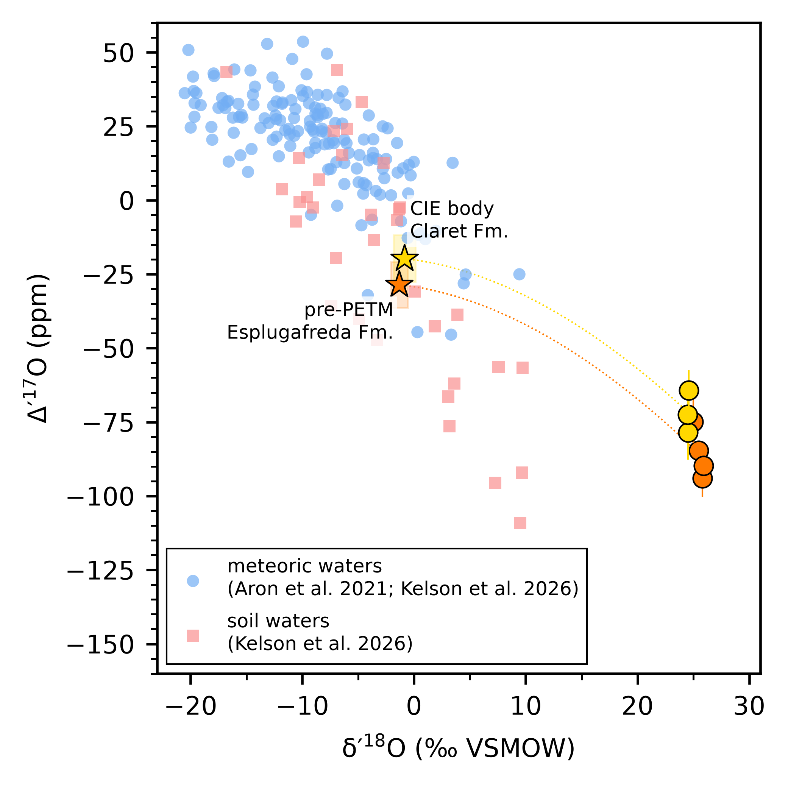

# Triple oxygen isotopes and reconstructed soil waters at Esplugafreda across the PETM

GitHub repository: [davidbajnai/esplugafreda](https://github.com/davidbajnai/esplugafreda).

## Graphical abstract

The workflow combines triple oxygen isotopes measured in this study with published carbonate δ18O and clumped isotopes temperature estimates to reconstruct soil-water compositions before and during the PETM.

## Scripts

### [scale_data.py](codes/scale_data.py)

Scales replicate isotope measurements and produces sample-average carbonate compositions and measurement diagnostics.

- Input: [replicate_data.csv](data/input/replicate_data.csv).
- Tables: [replicate_data_scaled.csv](data/output/csv/replicate_data_scaled.csv) ([XLSX](data/output/xlsx/replicate_data_scaled.xlsx)) and [replicate_data_scaled_averaged.csv](data/output/csv/replicate_data_scaled_averaged.csv) ([XLSX](data/output/xlsx/replicate_data_scaled_averaged.xlsx)).
- Figures: measurement-sequence diagnostics and a comparison of replicate and sample-average compositions, saved to the [PNG](figures/png/) and [SVG](figures/svg/) directories. These scaling figures are not currently present; their expected filenames are listed below.

### [plot_data_per_sample.py](codes/plot_data_per_sample.py)

Reconstructs individual soil-water compositions and compares carbonate and water isotope data.

- Inputs: [replicate_data_scaled_averaged.csv](data/output/csv/replicate_data_scaled_averaged.csv), [sample_info.csv](data/input/sample_info.csv), and [Aron_2021.csv](data/input/water_data/Aron_2021.csv).
- Tables: [all_data.csv](data/output/csv/all_data.csv) ([XLSX](data/output/xlsx/all_data.xlsx)) and [reconstructed_soil_water.csv](data/output/csv/reconstructed_soil_water.csv).
- Figures: [carbonates_per_sample.png](figures/png/carbonates_per_sample.png) ([SVG](figures/svg/carbonates_per_sample.svg)) and [d18O_AC_vs_d18O.png](figures/png/d18O_AC_vs_d18O.png) ([SVG](figures/svg/d18O_AC_vs_d18O.svg)).

### [plot_data_averaged_water.py](codes/plot_data_averaged_water.py)

Summarizes reconstructed soil waters by period, compares them with published water data, and exports the manuscript sample table.

- Inputs: [replicate_data_scaled_averaged.csv](data/output/csv/replicate_data_scaled_averaged.csv), [sample_info.csv](data/input/sample_info.csv), [Aron_2021.csv](data/input/water_data/Aron_2021.csv), [Kelson_2026_meteoric_water.csv](data/input/water_data/Kelson_2026_meteoric_water.csv), and [Kelson_2026_soil_water.csv](data/input/water_data/Kelson_2026_soil_water.csv).
- Tables: [reconstructed_water_averaged.csv](data/output/csv/reconstructed_water_averaged.csv) ([XLSX](data/output/xlsx/reconstructed_water_averaged.xlsx)), [reconstructed_soil_water.csv](data/output/csv/reconstructed_soil_water.csv), and [table_S4.xlsx](data/output/xlsx/table_S4.xlsx).
- Figure: [carbonates_averaged_water.png](figures/png/carbonates_averaged_water.png) ([SVG](figures/svg/carbonates_averaged_water.svg)).

### Supporting modules

| Module | Purpose | Inputs and outputs |
| --- | --- | --- |
| [reconstruct_water_Dp17O.py](codes/reconstruct_water_Dp17O.py) | Reconstructs water Δ′17O from carbonate compositions and temperature. | Receives values from the plotting scripts and returns reconstructed values; no standalone file inputs or outputs. |
| [_helper_functions.py](codes/_helper_functions.py) | Provides shared isotope calculations and table export. | Receives data from the analysis scripts and writes their CSV/XLSX tables. |
| [_plot_style.py](codes/_plot_style.py) | Provides shared figure styling and export. | Receives figures from the plotting scripts and writes their PNG/SVG outputs. |

## Data contents

| Input | Contents |
| --- | --- |
| [replicate_data.csv](data/input/replicate_data.csv) | Replicate and reference-standard isotope measurements, analytical uncertainties, and measurement metadata. |
| [sample_info.csv](data/input/sample_info.csv) | Sample and stratigraphic information, carbonate isotope compositions, and clumped isotopes temperature estimates with uncertainties. |
| [Aron_2021.csv](data/input/water_data/Aron_2021.csv) | Modern water isotope compositions and associated metadata. |
| [Kelson_2026_meteoric_water.csv](data/input/water_data/Kelson_2026_meteoric_water.csv) | Meteoric-water isotope compositions. |
| [Kelson_2026_soil_water.csv](data/input/water_data/Kelson_2026_soil_water.csv) | Soil-water isotope compositions. |
| [Beershaw_2020.csv](data/input/water_data/Beershaw_2020.csv) | Additional water isotope data, not used by the current scripts. |

| Output table | Contents |
| --- | --- |
| [replicate_data_scaled.csv](data/output/csv/replicate_data_scaled.csv) ([XLSX](data/output/xlsx/replicate_data_scaled.xlsx)) | Scaled sample-replicate isotope compositions. |
| [replicate_data_scaled_averaged.csv](data/output/csv/replicate_data_scaled_averaged.csv) ([XLSX](data/output/xlsx/replicate_data_scaled_averaged.xlsx)) | Sample-average isotope compositions, uncertainties, replicate counts, and acid-corrected carbonate values. |
| [all_data.csv](data/output/csv/all_data.csv) ([XLSX](data/output/xlsx/all_data.xlsx)) | Combined carbonate measurements, sample metadata, and individual water reconstructions with uncertainties. |
| [reconstructed_soil_water.csv](data/output/csv/reconstructed_soil_water.csv) | Individual soil-water reconstructions, period assignments, reconstruction inputs, and uncertainties. |
| [reconstructed_water_averaged.csv](data/output/csv/reconstructed_water_averaged.csv) ([XLSX](data/output/xlsx/reconstructed_water_averaged.xlsx)) | Period-average reconstructed water compositions and temperatures, sample counts, and within-period sample SD. |

| [table_S4.xlsx](data/output/xlsx/table_S4.xlsx) | Manuscript sample table on the Table_S4 sheet: composite depths, intervals, replicate counts, CO2 isotope compositions with 68% CI half-widths, acid-corrected carbonate compositions, published IRMS δ18O with 1σ, clumped isotopes temperatures with 1SE, and reconstructed water δ18O and Δ′17O with uncertainty envelopes. Delta values and their uncertainties display two decimal places; Δ′17O values and their uncertainties display integers. Headers use plain digits for isotope numbers and the true prime character (′). Only the header row has a background fill. Repeated metadata entries are represented by their arithmetic means. |

## Figures

| Figure | Content |
| --- | --- |
| [carbonates_per_sample.png](figures/png/carbonates_per_sample.png) ([SVG](figures/svg/carbonates_per_sample.svg)) | Carbonate compositions, individual reconstructed waters with uncertainty rectangles, calcite–water equilibrium curves, and period annotations. |
| [carbonates_averaged_water.png](figures/png/carbonates_averaged_water.png) ([SVG](figures/svg/carbonates_averaged_water.svg)) | Individual carbonate compositions and period-average reconstructed-water stars with ±1 SD rectangles and equilibrium curves. Labels positioned relative to the corresponding stars identify pre-PETM waters from the Esplugafreda Fm. and CIE-body waters from the Claret Fm. Comparison data include combined meteoric waters from Aron et al. (2021) and Kelson et al. (2026), and soil waters from Kelson et al. (2026). |
| [d18O_AC_vs_d18O.png](figures/png/d18O_AC_vs_d18O.png) ([SVG](figures/svg/d18O_AC_vs_d18O.svg)) | Carbonate δ18O measured in this study compared with metadata values attributed to Ujvari et al. (2025), with a 1:1 reference line. |

The following figures are generated by [scale_data.py](codes/scale_data.py) but are currently absent. Links point to their expected output locations.

| Expected figure | Content |
| --- | --- |
| [replicates_a.png](figures/png/replicates_a.png) ([SVG](figures/svg/replicates_a.svg)) and [replicates_b.png](figures/png/replicates_b.png) ([SVG](figures/svg/replicates_b.svg)) | Unscaled CO2 Δ′17O and CO2 mismatch versus measurement date for each measurement sequence. |
| [replicates_d-e.png](figures/png/replicates_d-e.png) ([SVG](figures/svg/replicates_d-e.svg)) | Scaled replicate and sample-average CO2 isotope compositions. |

## License

All files in this repository are available under [CC0 1.0](LICENSE). No rights reserved.
